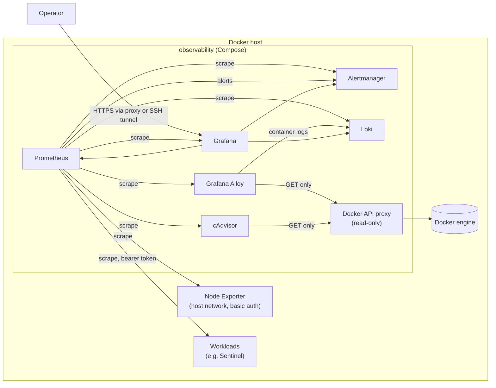

# Cloud-Native Observability & IaC Stack

[](https://github.com/ali-fakhrabadi/cloud-native-observability-iac/actions/workflows/ci.yml)
[](LICENSE)

Metrics, logs, alerting and dashboards for Linux hosts and Docker workloads, provisioned
entirely as code: Prometheus, Alertmanager, Grafana, Loki, Grafana Alloy, Node Exporter
and cAdvisor in Docker Compose, Linux hardening and deployment with Ansible, and AWS
infrastructure with Terraform.

> **Status:** under active development. The container stack, its configuration and the
> CI smoke test are in place. Alert rules, dashboards, the Ansible roles and the Terraform
> modules are added phase by phase (see [Roadmap](#roadmap)).

## Architecture



| Component | Version | Role |
|---|---|---|
| Prometheus | 3.15.1 | Metrics storage, scraping, alert rule evaluation |
| Alertmanager | 0.34.1 | Alert grouping, inhibition and notification routing |
| Grafana | 13.2.4 | Dashboards and log exploration, provisioned from files |
| Loki | 3.7.9 | Log storage (single binary, filesystem, 14-day retention) |
| Grafana Alloy | 1.21.2 | Collects every container's logs (Promtail's successor; Promtail reached end of life in March 2026) |
| Node Exporter | 1.12.1 | Host CPU, memory, disk, filesystem and network metrics |
| cAdvisor | 0.60.6 | Per-container CPU, memory, network and disk I/O |
| docker-socket-proxy | 0.5.0 | Read-only Docker API for Alloy and cAdvisor |

## Security design

* **No component holds the Docker socket.** Alloy and cAdvisor reach a proxy that allows
  only read endpoints (containers, networks, events, info, version); writes are disabled.
* **Network segmentation.** Loki, Alloy, cAdvisor and the proxy sit on internal networks
  without internet access. Only Prometheus (scraping), Alertmanager (notifications) and
  Grafana (UI) have egress. Prometheus and Alertmanager publish on `127.0.0.1` only.
* **Authenticated metrics.** Node Exporter (host network) and Grafana's `/metrics` require
  basic auth; Prometheus reads the credentials from Docker secrets.
* **Secrets as files.** `make secrets` generates passwords into `./secrets` (directory
  `0700`), mounted read-only as Docker secrets; nothing secret is in Git, `.env` or the
  configuration files.
* **Hardened containers.** Read-only root filesystems, all Linux capabilities dropped,
  `no-new-privileges`, CPU and memory limits, log rotation, health checks.
* **Pinned and verified.** Exact image versions (updated by Dependabot), hash-pinned Python
  tooling, GitHub Actions pinned to commit SHAs.

## Quick start

Requirements: Linux with Docker Engine and Compose v2, GNU make, openssl, python3.

```bash
make env       # .env from .env.example
make secrets   # passwords and the Node Exporter bcrypt hash in ./secrets
make up        # start and wait until every service is healthy
make smoke     # end-to-end check: targets up, datasources healthy, logs in Loki
```

Grafana listens on `http://127.0.0.1:3000` (user `admin`, password in
`secrets/grafana_admin_password`). Set `GRAFANA_BIND_ADDRESS=0.0.0.0` in `.env` to reach it
from other machines, ideally behind a TLS-terminating reverse proxy.

To monitor a [Sentinel](https://github.com/ali-fakhrabadi/sentinel-iam-audit-service)
deployment, copy `config/prometheus/targets/sentinel.yml.example` to `sentinel.yml`, set
its address, and put Sentinel's `METRICS_AUTH_TOKEN` into `secrets/sentinel_metrics_token`.

| Command | Purpose |
|---|---|
| `make validate` | Compose, `promtool`, `amtool`, Loki and Alloy checks with the pinned binaries |
| `make lint` | yamllint and shellcheck |
| `make reload` | Re-read Prometheus and Alertmanager configuration |
| `make logs SERVICE=loki` | Follow one service's logs |
| `make destroy` | Remove the stack and all stored data |

## Roadmap

1. Container stack, configuration, secrets and CI smoke test **(done)**
2. Alert rules with unit tests, Alertmanager routing, log parsing and Grafana dashboards
3. Ansible roles `linux_hardening` (SSH, UFW, fail2ban) and `observability_stack`, tested
   with Molecule
4. Terraform for an AWS VPS and firewall, tested with `terraform test` and mocked providers
5. Measured fault-injection drills, documentation and release

## License

[MIT](LICENSE)
