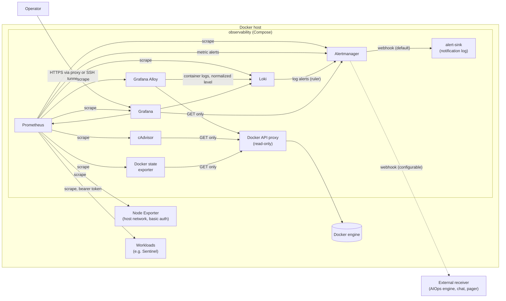
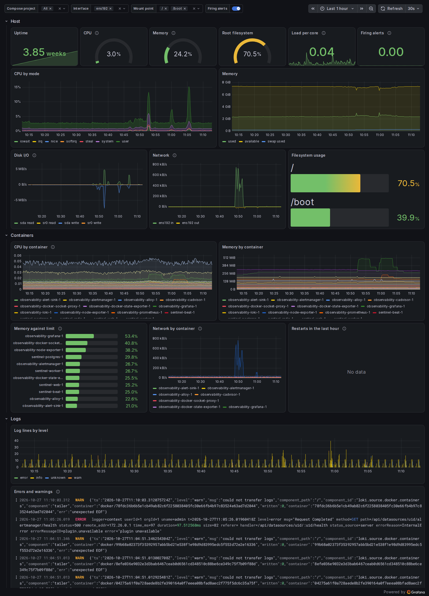

# Cloud-Native Observability & IaC Stack

[](https://github.com/ali-fakhrabadi/cloud-native-observability-iac/actions/workflows/ci.yml)
[](LICENSE)

Metrics, logs, alerting and dashboards for Linux hosts and Docker workloads, provisioned
entirely as code: Prometheus, Alertmanager, Grafana, Loki, Grafana Alloy, Node Exporter
and cAdvisor in Docker Compose, Linux hardening and deployment with Ansible, and AWS
infrastructure with Terraform.

> **How it is verified:** every component is checked in CI (configuration
> validation, alert rule unit tests, an end-to-end smoke test, Molecule for the Ansible
> roles, `terraform test` with a mocked provider), and fault-injection drills on a lab
> host measured how fast real failures reach a receiver ([results](#measured-not-estimated)).

## Architecture



| Component | Version | Role |
|---|---|---|
| Prometheus | 3.15.1 | Metrics storage, scraping, alert rule evaluation |
| Alertmanager | 0.34.1 | Alert grouping, inhibition and notification routing |
| Grafana | 13.2.4 | Dashboards and log exploration, provisioned from files |
| Loki | 3.7.9 | Log storage (single binary, filesystem, 14-day retention) |
| Grafana Alloy | 1.21.2 | Collects every container's logs (Promtail's successor; Promtail reached end of life in March 2026) |
| Node Exporter | 1.12.1 | Host CPU, memory, disk, filesystem and network metrics |
| cAdvisor | 0.60.6 | Per-container CPU, memory, network and disk I/O |
| docker-socket-proxy | 0.5.0 | Read-only Docker API for Alloy, cAdvisor and the Docker state exporter |
| docker-state-exporter | (this repository) | Restart counts, states and health checks as Docker reports them (cAdvisor misses containers stopped between restarts) |
| alert-sink | (this repository) | Default webhook receiver: logs every notification as JSON, so it lands in Loki |

## Alerting

26 alerts, each with a severity, a summary, a description (with the measured value where it means something) and a
[runbook](docs/runbooks.md). Metric alerts are Prometheus rules
([`config/prometheus/rules`](config/prometheus/rules)); log alerts are Loki ruler rules
([`config/loki/rules`](config/loki/rules)). Both go to the same Alertmanager.

| Area | Alerts |
|---|---|
| Host | CPU, memory, OOM kills, disk space (warning and critical), disk full within 24 h (linear prediction), inodes |
| Containers | Crash loops (counted by Docker), failing health checks, stopped services, memory near limit, CPU-bound throttling |
| Services | Scrape target down; Sentinel 5xx spike, p95 latency, webhook outbox backlog, failing webhook deliveries, rejected events |
| Logs | Error bursts in any container, errors in Sentinel |
| Meta-monitoring | Watchdog heartbeat, rule evaluation failures, notifications failing (Prometheus to Alertmanager, Alertmanager to receivers), dropped logs, unhealthy Alloy components |

Design choices that keep alerts actionable:

* **Tested like code.** `promtool` unit tests cover every rule, where it must fire and
  where it must stay quiet (short spikes, low traffic, tmpfs, recreated or one-off
  containers, throttled but idle containers), including the exact rendered text.
  `amtool` tests the routing. A check fails CI if an alert has no runbook.
* **Ratios and traffic floors.** The 5xx alert fires on the share of failed requests with
  a minimum request rate, so one error at night does not page anyone.
* **Severity routing.** Critical alerts are sent within about 10 seconds and repeated
  hourly; warnings are grouped and repeated every 4 hours. Inhibition suppresses the
  disk warning when the critical one fires, latency when the 5xx alert fires, and alerts
  derived from a target that is down.
* **Dead man's switch.** The always-firing Watchdog has its own route and is re-sent every
  5 minutes; a receiver that stops getting it knows alerting is broken.
* **No hardcoded receivers.** The webhook URL is a Docker secret
  (`secrets/alertmanager_webhook_url`), by default the bundled `alert-sink`.

## Logs

Alloy discovers every container through the read-only Docker API and labels its logs with
`container`, `compose_project`, `compose_service`, `stream` and `host`. It then:

* **normalizes `level`** to `debug`, `info`, `warn`, `error` or `fatal` from JSON and
  logfmt (`level` field), glog (cAdvisor) and PostgreSQL formats, so one query and one
  alert rule work across all services;
* **keeps request IDs searchable without new streams:** Sentinel's `request_id` and
  `logger` become structured metadata, so `{compose_project="sentinel"} | request_id="..."`
  follows one request through its logs;
* **drops noise on purpose:** successful Docker API calls from the proxy (one line per
  request) are filtered, and counted as filtered rather than lost.

## Dashboards

Generated by [`tools/dashboards/build.py`](tools/dashboards/build.py) (dashboards as code)
into [`config/grafana/dashboards`](config/grafana/dashboards) and provisioned read-only.
`make check-dashboards` runs every panel query against the live stack; CI fails if a query
errors or if the JSON differs from the generator.

| Dashboard | Content |
|---|---|
| Linux & Docker overview | Host gauges (CPU, memory, disk, load), CPU by mode, memory, disk and network I/O, filesystem usage; per-container CPU, memory, limits, network and restarts; log volume by level and an errors and warnings stream; filters for Compose project, interface and mount point |
| Sentinel IAM & Audit Service | Request rate, 5xx ratio, latency percentiles and slowest views, audit ingestion by outcome, webhook outbox and deliveries, container CPU, logs filtered by level |
| Observability stack health | Targets, firing alerts, series and samples, log throughput (sent, dropped, filtered), notifications, rule evaluation time, stack memory |

Captured with `make screenshots` on the lab host, an hour of normal operation after the
fault-injection drills; the host panels are narrowed to the main network interface and
the root and boot filesystems with the dashboard's own variables:



More: [Sentinel IAM & Audit Service](docs/images/sentinel-service.png),
[Observability stack health](docs/images/observability-stack.png).

## Measured, not estimated

Numbers from the lab host and from CI, each reproducible with a `make` target:

| What | Result | Details |
|---|---|---|
| Fault to notification (median of 3 rounds) | Crash loop 58 s, service down 2 min 28 s, memory near its limit 6 min 12 s, error-log burst 6 min 15 s, CPU throttled 19 min 53 s; mostly the rules' deliberate `for` periods | [Drills](docs/drills.md#results) |
| Problems the drills found | 2, fixed: a crash loop cAdvisor barely saw (notified after 627 s, now 57-69 s), and lost-looking logs after container restarts | [Drills](docs/drills.md#what-the-drills-found) |
| Stack footprint | 727 MiB memory and 0.08 CPU cores on average over 12 hours (13,000 series, 781 samples/s) | [Sizing](docs/sizing.md) |
| Disk growth | About 230 MB of Prometheus data per day | [Sizing](docs/sizing.md) |
| Bare Debian 12 to a deployed, smoke-tested stack | 2 min 42 s (Ansible, in CI) | [Sizing](docs/sizing.md#provisioning-time-measured-in-ci) |
| `make up` on a fresh CI runner, image pulls included | 48-66 s | [Sizing](docs/sizing.md#provisioning-time-measured-in-ci) |

## Security design

* **No component holds the Docker socket.** Alloy, cAdvisor and the Docker state exporter reach a proxy that allows
  only read endpoints (containers, networks, events, info, version); writes are disabled.
* **Network segmentation.** Loki, Alloy, cAdvisor, the Docker state exporter and the proxy sit on internal networks
  without internet access. Only Prometheus (scraping), Alertmanager (notifications) and
  Grafana (UI) have egress. Prometheus and Alertmanager publish on `127.0.0.1` only.
* **Authenticated metrics.** Node Exporter (host network) and Grafana's `/metrics` require
  basic auth; Prometheus reads the credentials from Docker secrets.
* **Secrets as files.** `make secrets` generates passwords into `./secrets` (directory
  `0700`), mounted read-only as Docker secrets; nothing secret is in Git, `.env` or the
  configuration files.
* **Hardened containers.** Read-only root filesystems, all Linux capabilities dropped,
  `no-new-privileges`, CPU and memory limits, log rotation, health checks.
* **Pinned and verified.** Exact image versions (updated by Dependabot), hash-pinned Python
  tooling, GitHub Actions pinned to commit SHAs.

## Quick start

Requirements: Linux with Docker Engine and Compose v2, GNU make, openssl, python3.

```bash
make env       # .env from .env.example
make secrets   # passwords and the Node Exporter bcrypt hash in ./secrets
make up        # start and wait until every service is healthy
make smoke     # end-to-end check: targets up, datasources healthy, logs in Loki
```

Grafana listens on `http://127.0.0.1:3000` (user `admin`, password in
`secrets/grafana_admin_password`). Set `GRAFANA_BIND_ADDRESS=0.0.0.0` in `.env` to reach it
from other machines, ideally behind a TLS-terminating reverse proxy.

To monitor a [Sentinel](https://github.com/ali-fakhrabadi/sentinel-iam-audit-service)
deployment, copy `config/prometheus/targets/sentinel.yml.example` to `sentinel.yml`, set
its address, and put Sentinel's `METRICS_AUTH_TOKEN` into `secrets/sentinel_metrics_token`.

| Command | Purpose |
|---|---|
| `make validate` | Compose, `promtool`, `amtool`, Loki and Alloy checks with the pinned binaries |
| `make test-rules` | Alert rule unit tests (`promtool`) and routing tests (`amtool`) |
| `make check-dashboards` | Run every dashboard query against the running stack |
| `make dashboards` | Regenerate the dashboard JSON from `tools/dashboards/build.py` |
| `make lint` | yamllint, shellcheck, dashboards up to date, every alert has a runbook |
| `make reload` | Apply configuration changes (SIGHUP for Prometheus and Alertmanager, restart for the rest) |
| `make logs SERVICE=loki` | Follow one service's logs |
| `make destroy` | Remove the stack and all stored data |
| `make ansible-lint` | ansible-lint with the production profile |
| `make test-ansible` | Molecule tests of both Ansible roles in disposable containers |
| `make terraform` | `terraform fmt` and `validate`, tflint, Trivy and `terraform test` (mocked AWS provider) |
| `make drills ROUNDS=3` | Fault-injection drills: inject real faults, measure time to alert, notification and resolution |
| `make footprint` | Memory, CPU, series, ingestion and disk use of the running stack, from its own metrics |
| `make screenshots` | Dark-mode PNG of every dashboard into `docs/images` |

## Ansible: hardening and deployment

Two roles in [`ansible/roles`](ansible/roles), applied by
[`playbooks/site.yml`](ansible/playbooks/site.yml) (hardening on every host, the stack on the
`monitoring` group):

```bash
cd ansible
cp -r inventories/example inventories/prod        # set addresses and variables
ansible-vault encrypt inventories/prod/group_vars/monitoring/vault.yml
ansible-playbook -i inventories/prod playbooks/site.yml --ask-vault-pass
```

**`linux_hardening`** (tested on Debian 12 and Ubuntu 24.04)

| Area | What it does |
|---|---|
| SSH | Keys only, no root login, 3 attempts, idle timeout, no agent/X11/remote forwarding, modern key exchange (including post-quantum `sntrup761x25519`), ciphers and MACs; a drop-in that takes precedence over distribution and cloud-init defaults, validated with `sshd -t` before reload |
| Lockout guard | Refuses to disable password logins while the admin user has no authorized key |
| Firewall (UFW) | Deny incoming by default; SSH allowed and rate limited *before* the firewall is enabled; every other port listed explicitly with its allowed source |
| fail2ban | SSH jail on the systemd journal, bans through UFW, a one-week ban for repeat offenders |
| Kernel | Redirect, source-routing and spoofing protection, SYN cookies, restricted `dmesg`, kernel pointers, ptrace and BPF, protected links and FIFOs; IP forwarding left to Docker |
| Updates | Unattended security updates only, no automatic reboot unless enabled |

**`observability_stack`** installs Docker Engine from Docker's signed repository (with
`live-restore` and log rotation), deploys this repository's stack to `/opt/observability`,
renders `.env` from variables, generates missing secrets with `scripts/generate_secrets.sh`,
takes the Sentinel token and receiver URL from Ansible Vault without logging them, starts
the stack with `docker_compose_v2`, applies configuration changes with SIGHUP or restarts,
and **fails the deployment unless the smoke test passes**. Set
`observability_stack_manage_docker: false` on hosts whose Docker must not be reconfigured.

**Tested in disposable machines.** `make test-ansible` (and CI) runs each role with
Molecule in privileged systemd containers: `linux_hardening` on Debian 12 and Ubuntu 24.04,
`observability_stack` on a bare Debian 12 where it installs Docker and deploys the whole
stack inside it. Each test converges, converges again and requires zero changes
(idempotence), then verifies the result: effective `sshd -T` settings, UFW rules, active
fail2ban jails, the lockout guard rejecting a user without keys, file permissions, the
smoke test and every dashboard query. Firewall rules in a test container stay in its own
network namespace, and kernel parameters are written but not applied there (most are not
namespaced and would change the test host).

> **Docker and UFW.** Ports that Docker publishes bypass UFW's rules (Docker inserts its own
> iptables rules first). That is why the stack publishes Prometheus and Alertmanager on
> `127.0.0.1` only and Grafana on `127.0.0.1` by default: expose Grafana through a reverse
> proxy on the host, or bind it to a private interface. Node Exporter runs in the host
> network, so UFW does apply to port 9100.

## Terraform: the AWS host

[`terraform/`](terraform) provisions one Debian 12 monitoring host on AWS and prints the
Ansible inventory for it (details in [`terraform/README.md`](terraform/README.md)):

| Module | Resources |
|---|---|
| `network` | VPC, a public subnet without automatic public IPs, internet gateway and route, the default security group stripped of its rules, flow logs of rejected traffic to CloudWatch Logs through a role scoped to its log group |
| `monitoring_host` | Security group (SSH and Grafana from listed networks only, web egress), instance with IMDSv2 required and a hop limit of 1, encrypted root volume, a separate encrypted data volume for `/var/lib/docker` with daily snapshots, Session Manager role, Elastic IP, cloud-init |

* **The security group is the perimeter.** Docker-published ports bypass UFW but not the
  security group, and validation refuses SSH or Grafana open to `0.0.0.0/0`.
* **Containers get no instance credentials:** the metadata service is unreachable from
  behind Docker's NAT.
* **Metrics and logs outlive the host.** Replacing the instance moves the data volume and
  the Elastic IP over; the volume is formatted only when blank, and Docker will not start
  without it.
* **No surprise replacements.** The Debian AMI is recorded at creation; newer releases do
  not replace the host until requested.

37 `terraform test` runs use a mocked AWS provider (no account, credentials or cost),
including negative tests for refused input; ten deliberate regressions each made them
fail. tflint (Terraform and AWS rules) and Trivy (MEDIUM and above fail the
build) run in CI. The configuration has not been applied to a real AWS account from this
repository: the mocks exercise its logic and the provider's validation, not the AWS APIs.

```bash
cd terraform/environments/example
cp backend.hcl.example backend.hcl && cp terraform.tfvars.example terraform.tfvars  # then edit both
terraform init -backend-config=backend.hcl && terraform apply
terraform output -raw ansible_inventory   # hosts.yml for ansible/inventories/<name>/
```

## Roadmap

1. Container stack, configuration, secrets and CI smoke test **(done)**
2. Alert rules with unit tests, Alertmanager routing, log parsing and Grafana dashboards
   **(done)**
3. Ansible roles `linux_hardening` (SSH, UFW, fail2ban) and `observability_stack`, tested
   with Molecule **(done)**
4. Terraform for an AWS host and its firewall, tested with `terraform test` and a mocked
   provider, tflint and Trivy **(done)**
5. Measured fault-injection drills, resource footprint, screenshots and documentation
   **(done)**

## License

[MIT](LICENSE)
