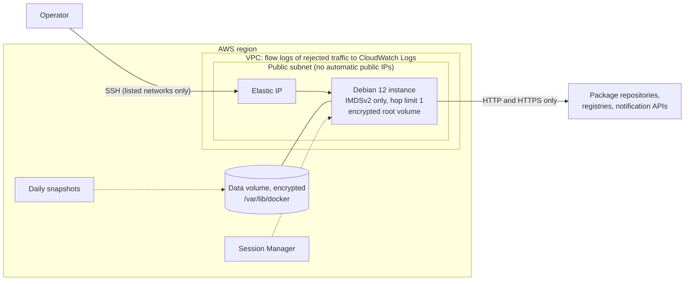

# Terraform: the AWS monitoring host

One Debian 12 host on AWS for the observability stack, ready for the Ansible playbook.
Terraform provisions the network, firewall, instance and storage; cloud-init only creates
the admin account and mounts the data volume; Ansible does the rest (hardening, Docker,
the stack).



| Path | Contents |
|---|---|
| [`modules/network`](modules/network) | VPC, one public subnet, internet gateway and default route, the default security group stripped of its rules, VPC flow logs |
| [`modules/monitoring_host`](modules/monitoring_host) | Security group, instance, data volume and its snapshot policy, Session Manager role, Elastic IP, cloud-init |
| [`environments/example`](environments/example) | Both modules with provider default tags, an S3 backend and the outputs Ansible needs |

## Usage

Requirements: Terraform 1.11 or later, AWS credentials, and an S3 bucket for the state.

```bash
cd terraform/environments/example
cp backend.hcl.example backend.hcl            # state bucket and key
cp terraform.tfvars.example terraform.tfvars  # your SSH key and public address
terraform init -backend-config=backend.hcl
terraform apply

# Hand the host over to Ansible (from the repository root):
cp -r ansible/inventories/example ansible/inventories/aws
terraform -chdir=terraform/environments/example output -raw ansible_inventory > ansible/inventories/aws/hosts.yml
cd ansible && ansible-playbook -i inventories/aws playbooks/site.yml --ask-vault-pass

# Grafana listens on the host's loopback; reach it through SSH:
terraform -chdir=terraform/environments/example output -raw grafana_tunnel_command
```

The playbooks first wait for cloud-init to finish, so Docker is never installed before
the data volume is mounted.

| Input (example environment) | Default | Purpose |
|---|---|---|
| `ssh_public_keys` | required | OpenSSH public keys of the operators |
| `ssh_ingress_cidrs` | required | Networks allowed to reach SSH; `0.0.0.0/0` is refused, `[]` leaves Session Manager only |
| `grafana_ingress_cidrs` | `[]` | Networks allowed to reach Grafana on port 3000 directly |
| `instance_type` | `t3.medium` | 2 vCPU, 4 GiB. The stack used about 710 MiB on the lab host monitoring one service; its memory limits add up to 3.5 GiB |
| `data_volume_size` | `30` | GiB for metrics, logs and dashboards (Prometheus keeps 15 days or 5 GB) |
| `region`, `project`, `environment`, `vpc_cidr` | `eu-central-1`, `observability`, `lab`, `10.20.0.0/16` | Placement and naming |

The modules take more: `extra_egress_rules` for scrape targets outside the host,
`ssh_port`, `architecture = "arm64"` for Graviton types, `ami_id`, `kms_key_arn` for
customer-managed keys, `data_volume_snapshot_retention`, `ssm_enabled`,
`termination_protection`, and the flow log settings. Every input is typed, documented and
validated in the modules' `variables.tf`.

## Design

* **The security group is the perimeter.** Ports Docker publishes bypass UFW, but not the
  security group: SSH and Grafana are open only to listed IPv4 networks (validation
  refuses `0.0.0.0/0`, host bits and IPv6), and egress is limited to HTTP and HTTPS plus
  explicitly listed rules. Security groups do not filter traffic to the Amazon DNS
  resolver, the Time Sync Service or the metadata service, so those need no rule. The
  VPC's default security group is adopted, which removes its rules.
* **Containers get no instance credentials.** The metadata service requires IMDSv2 tokens
  with a hop limit of 1: processes on the host reach it, containers behind Docker's NAT do
  not. The instance role only allows Session Manager.
* **The data outlives the host.** Docker's data directory, which holds every volume of the
  stack, is a separate encrypted gp3 volume. A new instance (new AMI, changed cloud-init)
  gets the same volume and Elastic IP. The mount script waits for the attachment, formats
  only a blank volume, mounts by UUID and makes `docker.service` require the mount.
  Snapshots are taken daily (7 kept, crash-consistent, which Prometheus and Loki recover
  from through their write-ahead logs), and a final snapshot when the volume is destroyed.
* **No surprise replacements.** The newest official Debian 12 AMI is looked up once and
  recorded. A later Debian release does not replace the host until you ask for it with
  `terraform apply -replace='module.monitoring_host.terraform_data.ami[0]'`, or set `ami_id`.
* **One account, keys only.** cloud-init replaces the AMI's default user with `deploy`
  (group `sudo`, locked password, your keys) and disables password and root logins. The
  Ansible hardening role then enforces the SSH policy.
* **State and versions.** Encrypted S3 state with S3-native locking (no DynamoDB table);
  the provider is pinned in the committed lock file, and default tags mark every resource
  with project, environment and `ManagedBy = terraform`.

## Tests and checks

`make terraform` (and the CI job of the same name) runs every check in pinned containers:

| Check | What it covers |
|---|---|
| `terraform fmt -check`, `terraform validate` | Formatting and configuration validity of both modules and the environment |
| `tflint --recursive` | Every Terraform language rule (naming, typed and documented variables and outputs, unused declarations, module structure) and the AWS ruleset (for example invalid instance types) |
| Trivy | 71 misconfiguration checks pass; MEDIUM and above fail the build. One documented exception: web egress to `0.0.0.0/0` (AWS-0104), since package mirrors and registries have no fixed addresses |
| `terraform test` | 37 test runs with a mocked AWS provider: no account, credentials or cost |

The tests assert on plans and on mocked applies: IMDSv2 and the hop limit, encryption,
security group rules, the decoded cloud-init document, volume and Elastic IP wiring, the
Session Manager and snapshot roles, the Ansible inventory, and the AMI staying the same
when a newer one is published. Negative tests check that bad input is refused: SSH open
to `0.0.0.0/0`, CIDRs with host bits or IPv6, private key material passed as a public key,
`root` as admin user, a subnet outside the VPC. Ten deliberate regressions (IMDSv1, a hop
limit of 2, open SSH, an unencrypted data volume, a flow log role widened to `*`, an
unfrozen AMI, an instance profile left attached after Session Manager is disabled, and
others) each made the tests fail.

**Limits.** This configuration has not been applied to a real AWS account from this
repository. The mocked provider exercises the configuration's logic and the provider's
own argument validation, not the AWS APIs. The mount script is checked with ShellCheck,
not booted on EC2.

## Restricted networks

Where `registry.terraform.io` is unreachable, download the provider on a connected
machine with `terraform providers mirror -platform=linux_amd64 <dir>`, copy the directory
over and set `TERRAFORM_PROVIDER_MIRROR=<dir>` in `.env`: the Makefile then installs from it
through [`mirror.tfrc`](mirror.tfrc), and the lock file still verifies the checksums.
tflint verifies its AWS plugin through Sigstore; without access to it, place a verified
plugin binary in `.cache/tflint/github.com/terraform-linters/tflint-ruleset-aws/<version>/`.
